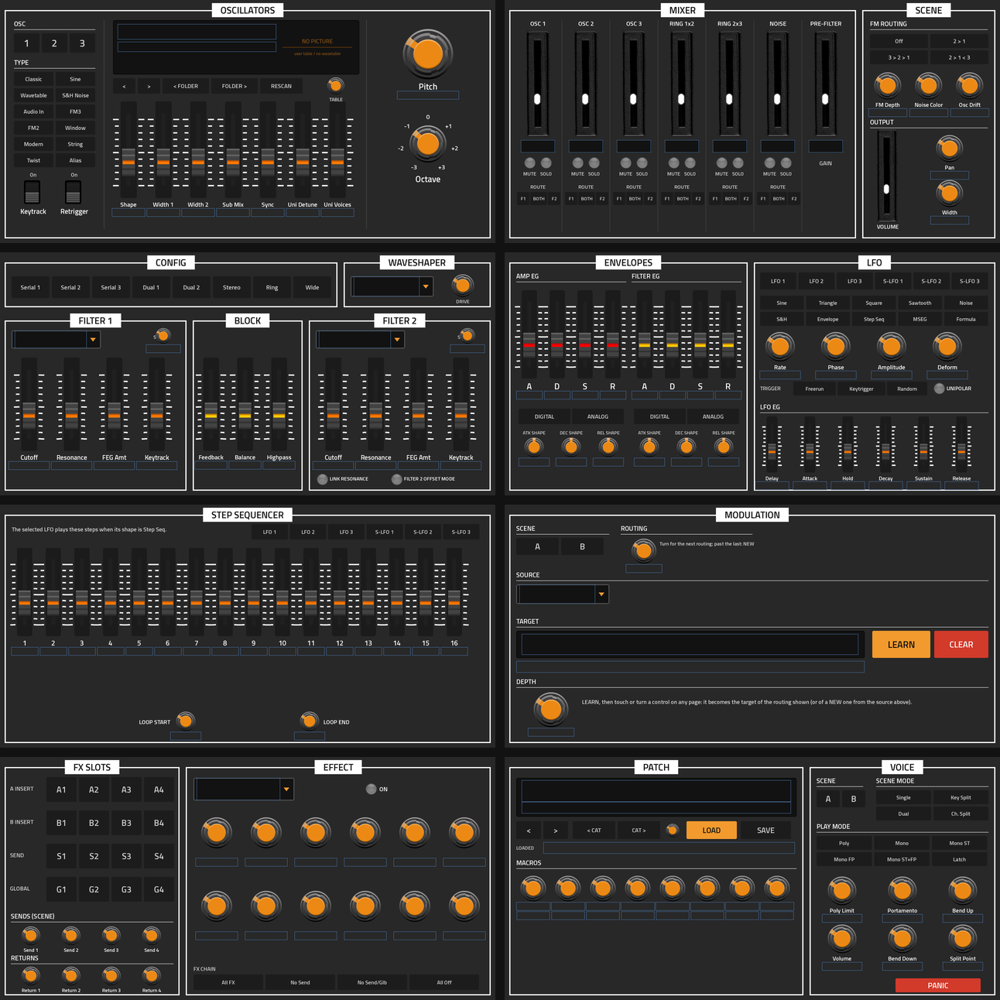

# SurgeXXL v0.1.2



**Surge XT, the Surge Synth Team's open-source hybrid synthesizer, as a native instrument for the Akai Force (MPC OS
3.x, VST2 through [mpc-vst-plugins](https://github.com/sd88me/mpc-vst-plugins)).**

SurgeXXL is Surge XT 1.3.4's own sound engine, built headless (the way Surge's VCV Rack modules build it) for the
Force's 32-bit ARM, with eight pages drawn in the look of [InterzoneXXL](https://github.com/sunskiefer/InterzoneXXL)
(Valley's sliders and Rogan knobs, VCV's switches) and the mixer faders and lit keys of
[LXRXXL BAZZLINE](https://github.com/sunskiefer/LXRXXL-BAZZLINE). It plays every Surge factory and third-party patch
(3008) and wavetable (761), loads your own patches and wavetables, saves your sounds, and keeps everything with the
MPC project.

> [!NOTE]
> **Status: 0.1.2, being tested on a Force: LOAD has crashed MPC (0.1.0 and 0.1.1). 0.1.2 writes a crash log, `/sdcard/SurgeXXL/surgexxl.log`; if it crashes, that file says where.** Every build is tested offline: the engine and mpc-vst-plugins' host
> test on x86, and the Force binary itself under an ARM emulator (see [Testing](#testing)). The first device test
> decides the voice count a Force can carry (see [CPU](#cpu)). Report anything odd under Issues.

## What's in it

- **Surge XT's engine, unchanged**: 2 scenes, 3 oscillators each (Classic, Sine, Wavetable, S&H Noise, Audio In, FM3,
  FM2, Window, Modern, String, Twist, Alias), 2 filters per voice in 8 configurations with all of Surge's filter types,
  the waveshaper, Amp and Filter EG, 6 voice and 6 scene LFOs (Step Seq, MSEG, Formula and the rest), the modulation
  matrix, 16 FX slots (every Surge effect but Spring Reverb), the 8 macros; MIDI notes and velocity, pitch bend, channel and poly pressure, mod wheel and the other CCs, sustain.
- **All the patches and wavetables**: Surge's factory and third-party collections, browsed by category.
- **Your own**: SAVE writes the sound as `SurgeXXL 001`, `002`... into `/sdcard/SurgeXXL/Patches/SurgeXXL`;
  wavetables (`.wt` or `.wav`) you copy into `/sdcard/SurgeXXL/Wavetables` appear in the list (RESCAN while the
  plugin is open). Your files come first in both lists.
- **Pictures of the wavetables**: the OSC page draws the selected table (all 761 shipped tables have one).
- **Every page on Q-Links**, 8 knobs per Q-Link page, in an order you can change with the SurgeXXL Q-Link Map.
- **Left out**: Spring Reverb (Surge's own build flags it as not working on 32-bit Linux). The 16 patches that use it
  load with that slot off. Airwindows (Surge's effect with 56 Airwindows algorithms inside) is in: 538 patches use it.
  MTS-ESP microtuning is off (it needs a host-wide library); Scala tunings in patches work.

## The pages

MPC shows eight tabs. Most pages show **the edited scene** (A or B: the SCENE buttons on MOD and PATCH, Surge's own
"Active Scene") and, where there are several, **the selected** oscillator, LFO or FX slot: pick one and every control
shows that one.

| Page | Controls |
|---|---|
| OSC | OSC 1/2/3, TYPE (12), the type's seven parameters (sliders, named for the type), Keytrack, Retrigger, Pitch, Octave; the wavetable: its name, folder and picture, `<` `>` (one table), `FOLDER` (the folder before / after), RESCAN, TABLE (a Q-Link through the list) |
| MIXER | Osc 1-3, Ring 1x2, Ring 2x3, Noise: level (fader, value in the window), MUTE, SOLO, ROUTE (F1 / BOTH / F2); Pre-Filter gain; FM routing and depth, Noise Color, Osc Drift; the scene's Volume, Pan, Width |
| FILTER | Filter configuration (8), waveshaper type and drive; Filter 1 and 2: type, subtype, cutoff, resonance, FEG amount, keytrack; Feedback, Balance, Highpass; Link Resonance, Filter 2 Offset Mode |
| ENV / LFO | Amp EG and Filter EG: A, D, S, R, Digital / Analog, the three shapes; LFO 1-3 and S-LFO 1-3 (Surge's voice LFOs 1-3 and scene LFOs 1-3): shape, rate, phase, amplitude, deform, trigger, unipolar, and its envelope (delay, attack, hold, decay, sustain, release) |
| STEP SEQ | The selected LFO's 16 steps (bipolar), loop start and end. The LFO plays them when its shape is Step Seq |
| MOD | The scene's modulation routings: ROUTING (turn through them; past the last one: NEW), SOURCE, TARGET (LEARN, then touch or turn any control on any page), DEPTH, CLEAR |
| FX | The 16 slots (A and B inserts, sends, globals 1-4); the selected slot's type, its twelve parameters (named for the type), On; the scene's four send levels and the four returns; FX Chain bypass |
| PATCH | The patch browser (`<` `>`, `CAT`, PATCH on a Q-Link), LOAD, SAVE, the loaded patch's name; the 8 macros with the patch's own names; Scene A/B, Scene Mode, Play Mode, Poly Limit, Portamento, Bend Up / Down, Split Point, Volume, PANIC |

The other six voice LFOs and scene LFOs (Surge's 4-6) still run as the patches use them; the pages show 1-3 of each
because the Force's own automation covers the rest. MSEG and Formula LFOs play as the patch made them (they are
not edited here).

## Folders

The plugin finds its data next to its library (`<plugin folder>/data`: Surge's patches, wavetables, presets,
tunings) and keeps your files in a `SurgeXXL` folder beside the `Synths` folder it is installed in:
`/sdcard/SurgeXXL` for `/sdcard/Synths`, `/media/<card>/SurgeXXL` on a card. It makes `Patches/` and
`Wavetables/` there the first time it runs. Reinstalling or updating the plugin never touches it.

## Crash log

`/sdcard/SurgeXXL/surgexxl.log` (next to your Patches and Wavetables) records each instance, each LOAD and project
restore, and, if the plugin brings MPC down, where it happened. Attach it to an Issue.

## The project, presets and state

The whole sound is saved with the MPC project: every parameter, the modulation, the wavetables, the step sequences
and MSEGs (Surge's own patch format), plus what the pages are showing. It is larger than most plugins' state
(50-210 KB of text); see docs/UPSTREAM.md.

## CPU

SurgeXXL runs at MPC's 44.1 kHz with Surge's own 2x oversampled oscillators, on the Force's Cortex-A17 with NEON (the
build targets it). The polyphony limit is 2-32 (Surge's default 16; half of Surge's 64). A patch with many unison
voices costs more per note. The first device test measures it (mpc-vst-plugins `tools/bench.sh`).

## Q-Links

Each page's controls are on its Q-Link pages, 8 knobs each (the Force's eight knobs), in the order of `qlinks.json`.
Change the order with the **SurgeXXL Q-Link Map** (number the controls on a picture of each page, save
`surgexxl-qlinks.json`), then build with it as `qlinks.json`. Triggers (LOAD, SAVE, PANIC, LEARN...) are touch only.

## Building

```
git clone --recursive https://github.com/sunskiefer/SurgeXXL && cd SurgeXXL
pip install ziglang Pillow cairosvg       # plus cmake, ninja and a host gcc
./build.sh                                # -> build/package/ANDREALPHEUS - VST - SurgeXXL/
```
No Docker. `SXXL_WT_PICTURES=0 ./build.sh` builds without the wavetable pictures (a lighter skin).
Releases: mpc-vst-plugins' `tools/release.py` (docs/RELEASING.md there), license `GPL-3.0-or-later`.

## Testing

`test/run_tests.sh [x86|arm|all] [--patches all|N]`:
- `test/engine_test.cpp`: every parameter answers; continuous and option round trips; every Nth patch (or all) loads
  and plays a chord with bounded output, counting the patches that had a removed FX; every FX type plays; the
  wavetables (picture numbers, a user wavetable added and rescanned); SAVE; the state restored on a second instance;
  LEARN. On x86 and as the Force build under `qemu-arm`.
- mpc-vst-plugins' `tools/host_test.c` on the whole plugin (wrapper and engine): names, set/get, option stepping by
  wheel and Q-Link, the long lists' stepping, popups, note to audio, MPC's STOP quirk, the chunk, CC Q-Links, two threads.
- The skin: `./build.sh --skin-only`, then mpc-vst-plugins' `tools/studio.py preview` (the pages above are its output).

## Credits and licences

- **SurgeXXL** (the plugin layer, the pages, the tools): L'Cronx, GPL-3.0-or-later.
- **Surge XT**: the Surge Synth Team and contributors, originally by Claes Johanson (Vember Audio), GPL-3.0-or-later
  (`third_party/surge`, see `src/VENDORED.md`), with its libraries under their own licences: the sst libraries
  (GPL-3.0, MIT), LuaJIT (MIT), SIMDe (MIT), fmt (MIT), PEGTL (MIT), Mutable Instruments' eurorack code (MIT),
  libsamplerate (BSD-2), pffft (BSD-like), tuning-library (MIT), sqlite (public domain) and JUCE 7's core, audio
  basics, audio formats and DSP modules (GPL-3.0). The factory and third-party patches and wavetables are Surge's,
  by their authors, distributed with Surge under its licence.
- **Artwork**: Valley Audio's sliders and Rogan knobs (ValleyRackFree, GPL-3.0-or-later; the Rogan knobs are Valley's
  recolouring of VCV's Component Library, CC BY-NC 4.0), VCV's CKSS switch (CC BY-NC 4.0), as in InterzoneXXL;
  LXRXXL BAZZLINE's fader box, cap and lit key by Suns Kiefer; Titillium Web (SIL OFL 1.1).
  Because of the CC BY-NC 4.0 graphics, SurgeXXL is free and must not be sold.
- **mpc-vst-plugins** (the VST2 wrapper, the skin builder): sd88me and contributors.

SurgeXXL is not affiliated with or endorsed by the Surge Synth Team or Akai Professional.
